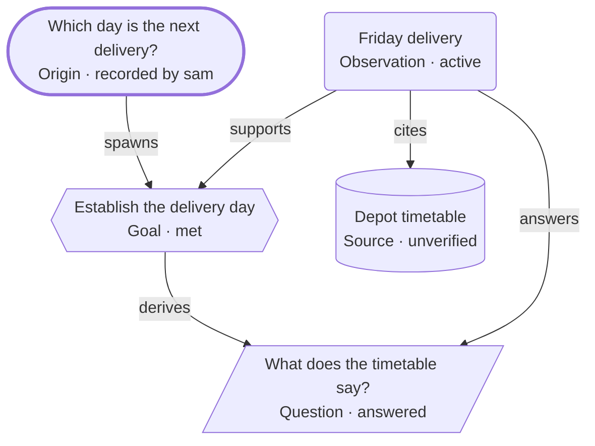
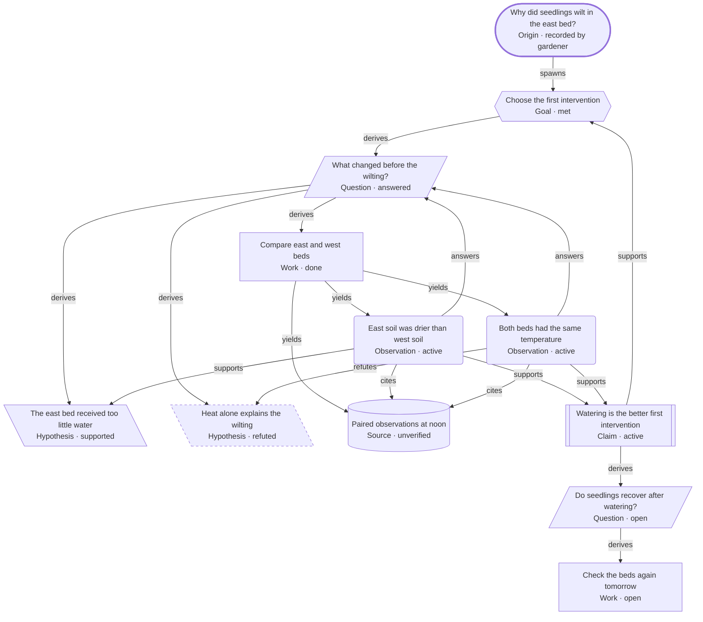

# ns-egraph

Track a bounded investigation in one local JSON file. Each question, hypothesis, source, observation, and claim has its own ID. Evidence links pin revisions so a reader can reconstruct why a goal was accepted. The CLI ranks open work, checks stop conditions, and renders Mermaid.

Copy `egraph.py` anywhere with Python 3.10+ and run it directly. It uses only the standard library. A graph path is relative to the caller's working directory unless you give an absolute path.

## Try a session

Run these commands in a directory with `egraph.py`, starting with a new graph file. Each write prints the assigned ID or revision. The example IDs apply to this sequence.

```sh
python3 egraph.py sample.json --actor sam init --title "Delivery schedule" --origin "Which day is the next delivery?"
python3 egraph.py sample.json add goal --title "Establish the delivery day"
python3 egraph.py sample.json add question --title "What does the timetable say?" --from goal-2 --refs order-42
python3 egraph.py sample.json frontier
python3 egraph.py sample.json add source --title "Depot timetable"
python3 egraph.py sample.json add observation --title "Friday delivery" --quote "Next delivery: Friday" --cites src-4
python3 egraph.py sample.json link answers obs-5 q-3
python3 egraph.py sample.json state q-3 answered
python3 egraph.py sample.json link supports obs-5 goal-2
python3 egraph.py sample.json accept goal-2 --edges e5 --rationale "The timetable gives an explicit day."
python3 egraph.py sample.json validate
python3 egraph.py sample.json overview
python3 egraph.py sample.json render > sample.mmd
```

The sample produces this top-down graph in `sample.mmd`. The origin node shows the original request and who recorded it.



Here the quote represents a sample input. In actual use, save or identify the underlying source. To see how a correction affects the decision, run `python3 egraph.py sample.json retract obs-5 --reason "Timetable superseded"`, then inspect `overview` again. The goal now needs review.

## Larger example

In this fictional greenhouse investigation, the east bed wilted while the west bed did not. A paired measurement supports low soil moisture and rules out heat alone for that comparison. The gardener chooses watering as the first intervention and leaves a follow-up question open to see whether the seedlings recover. The graph records a decision from the available evidence. Recovery still needs to be measured. Validation also warns that the evidence comes from a single unverified source and that the moisture hypothesis needs a test that could disconfirm it.

Explore the saved [graph](examples/greenhouse.json) and its [sample observations](examples/greenhouse-notes.md) from the project directory.

```sh
python3 egraph.py examples/greenhouse.json validate
python3 egraph.py examples/greenhouse.json overview
python3 egraph.py examples/greenhouse.json frontier
python3 egraph.py examples/greenhouse.json render
```



## Use with agents or scripts

- Set `--actor NAME` before the command on each write to attribute it. The default is `user`. Pass domain metadata as a JSON object with `--payload`. References supplied with `--refs` are opaque external IDs.
- Run `python3 egraph.py --help` for the command list or `python3 egraph.py sample.json add --help` for command options. Read commands emit JSON except for `render`, which writes Mermaid. Validation exits 1 for graph errors and 0 when it passes, including with warnings.
- For Python callers, import `Graph` from `egraph`. Use `Graph.new(title, origin)` or `Graph.load(Path(...))`, apply operations, and call `save(Path(...))` to persist. After a failed mutation, discard the in-memory working copy before saving.
- Use a single writer per graph. Each CLI write replaces the file atomically, but overlapping read-modify-write operations can lose updates. Node IDs are scoped to their graph.
- `verify-source` records an external verification verdict and a report reference. The caller verifies the artifact. After rejecting a source, review its cited observations and retract affected evidence to reopen dependent accepted goals.

## File format

Graphs use the `ns-egraph/1` JSON format.

## Recall and resume

Use a flat directory of graph JSON files for each project. Recall looks for exact graph and node references, aliases and external IDs, or a match on at least two distinctive title words. It expands the best match through up to two typed links. Output is capped at three entries and 1,500 characters. Each entry includes the node revision so you can check the underlying record. A miss prints nothing.

```sh
python3 recall.py recall examples "Did we rule out heat in the east bed?"
python3 recall.py recall examples "greenhouse.json#obs-9"
python3 recall.py recall examples "Explain photosynthesis"
```

To make an otherwise hard-to-match concept discoverable, give a node a short, unambiguous alias in its payload, such as `{"aliases":["heat"]}` in the greenhouse graph. Recall flags conclusions for review when their evidence is stale or their source was rejected. Use the graph itself to verify a conclusion before relying on it.

Save a checkpoint when you have a durable decision, blocker, or next step. Checkpoints store a graph pointer and an unresolved node ID. Graph edits persist through the existing CLI. A checkpoint reconstructs the resume context from the latest graph and can fall back to its open frontier when the specified item is resolved.

```sh
python3 recall.py checkpoint examples greenhouse.json --next q-11
python3 recall.py resume examples
python3 recall.py checkpoint examples greenhouse.json --done
```

Use `--session NAME` for separate tasks in the same project. The default session is `manual` outside an integrated host. Checkpoints are local JSON files in the memory directory's `.checkpoints/` subdirectory.

### Optional semantic recall

Semantic recall tries a local English embedding model after a text miss. Exact references, aliases, and lexical matches still take precedence. The model chooses a starting node from cached vectors for current node titles and observation text. The same graph walk retrieves related evidence and applies the same review checks. Similarity is a relevance signal, and weak matches produce no output.

From the tool directory, run the following commands. The first index build can download BAAI/bge-small-en-v1.5 with FastEmbed.

```sh
python3 -m venv .venv
.venv/bin/python -m pip install -r requirements-semantic.txt
.venv/bin/python recall.py index examples --download
.venv/bin/python recall.py recall examples "Why were the plants drooping?" --semantic
```

The memory directory's `.semantic/` stores the derived vectors and local model files. Run `recall.py index DIRECTORY` again after editing graphs to refresh changed nodes. Queries use cached vectors for current node revisions. Keep `.semantic/` out of Git.

## Automatic recall in agent hosts

From the project where you want memory, create `.ns-egraph/tool/` and `.ns-egraph/graphs/`. Copy `egraph.py`, `recall.py`, and the `integrations/` directory into `.ns-egraph/tool/`, preserving their relative paths. Ignore `.ns-egraph/` in the target project's Git config for private local memory. To try the example, copy `examples/greenhouse.json` into the graphs directory.

Both adapters enclose relevant context in a single `<ns_egraph_recall>` block. A short note says whether it came from a text match, a checkpoint, or a semantic match. The full block fits within 1,500 characters. On a miss, the hook is silent.

To opt in to embeddings, also copy `semantic_recall.py` and `requirements-semantic.txt` into the tool directory. Use the setup above with your project's graph directory. Point the hook command at the Python interpreter with FastEmbed installed, and append `--semantic` after its graph directory argument. The supplied hooks start in the tool directory, so `.venv/bin/python` works there if you created the environment as shown. Model downloads and index refreshes run through the explicit indexing command.

### Claude Code

Merge the two hook entries from [the settings example](integrations/claude/settings.json) into the project's `.claude/settings.local.json`. Copy [the agent rule](integrations/claude/rule.md) into `.claude/rules/ns-egraph.md`, or include it in your existing local project instructions. Restart Claude Code so it loads the hooks. [Claude Code hook reference](https://code.claude.com/docs/en/hooks)

- New prompts receive a short excerpt only when recall finds a match. The exact prompt `continue` or `resume` also checks for this session's active graph.
- Checkpoints written by the agent use the host session ID automatically. After compaction or when resuming that session, the adapter loads the latest saved pointer and next action. New sessions look up a named task through ordinary prompt recall.
- The agent rule tells the host when to persist work. The adapter reads saved records and has no transcript ingestion or background model calls. Removing its hook entries and agent rule disables automatic use.

### Kiro

Copy [hooks.json](integrations/kiro/hooks.json) to `.kiro/hooks/ns-egraph.json`. The hooks restore checkpoints at session start and after compaction. Post-compaction recovery requires Kiro IDE 1.4.121+ or Kiro CLI 3.1+ using the V3 engine. [Kiro hook triggers](https://kiro.dev/docs/hooks/types/)

Copy [the steering file](integrations/kiro/steering.md) to `.kiro/steering/ns-egraph.md`. For a custom agent, include the file in its resources. [Kiro steering](https://kiro.dev/docs/steering/)

On a relevant prompt, Kiro receives the same bounded excerpt as the CLI. An exact `continue` or `resume` looks up the checkpoint for the active Kiro session. Automatic recovery requires a checkpoint written with that session ID. The steering file explains how to save one and how to use a named checkpoint when the session ID is unavailable. Fresh sessions without a checkpoint, unrelated prompts, and unreadable memory produce no output.

Run the complete offline suite in `tests/` from the repository root with `python3 -B -m unittest -v`.

## Synthetic evaluations

The [development set](evals/cases.json) has 17 recall cases and four checkpoint cases across three fictional graphs. It checks whether an excerpt contains the expected revision-linked evidence, whether stale conclusions are flagged, whether a miss stays silent, and whether each hook restores the correct session. The runner builds the graphs and checkpoints in a temporary directory. [Evaluation design reference](https://huggingface.co/blog/agentic-evals)

Run the lexical baseline from the repository root. Use `--output` to save the prompts or hook events, expected results, actual output, and timings for inspection.

```sh
python3 -B -m evals.run --output /tmp/ns-egraph-eval.json
```

To compare lexical recall with semantic fallback on the same prompts, use the Python environment and model cache from [the semantic setup](#optional-semantic-recall).

```sh
.venv/bin/python -B -m evals.run --model-cache examples/.semantic/models \
  --output /tmp/ns-egraph-semantic-eval.json
```

The runner reports case failures separately from execution errors. The scores describe retrieval and hook output on this development set. Agent response quality in live hosts requires its own evaluation.
